# U-Boot Zone · Commander's Manual

For game version v1.8. This manual explains every part of the control room, how the boat
and its enemies behave, and how to fight a patrol. The [README](README.md) has the short
version; the in-game help (**H**) has the keys and a few reminders.

## Contents

1. [Your boat](#1-your-boat)
2. [The control room at a glance](#2-the-control-room-at-a-glance)
3. [The periscope](#3-the-periscope)
4. [Gauges and dials](#4-gauges-and-dials)
5. [Sonar](#5-sonar)
6. [Torpedo tubes and the torpedo data computer](#6-torpedo-tubes-and-the-torpedo-data-computer)
7. [Status lamps](#7-status-lamps)
8. [How the boat moves](#8-how-the-boat-moves)
9. [How the enemy finds you](#9-how-the-enemy-finds-you)
10. [The torpedo attack](#10-the-torpedo-attack)
11. [The enemy](#11-the-enemy)
12. [Dangers](#12-dangers)
13. [Missions](#13-missions)
14. [Time of day, sea and fog](#14-time-of-day-sea-and-fog)
15. [Patrols, score and difficulty](#15-patrols-score-and-difficulty)
16. [Tactics](#16-tactics)
17. [Quick reference](#17-quick-reference)
18. [The AI captain and the first officer](#18-the-ai-captain-and-the-first-officer)
19. [Screen and text size](#19-screen-and-text-size)
20. [Blueprints](#20-blueprints)
21. [The deck gun](#21-the-deck-gun)
22. [The chart](#22-the-chart)
23. [What you hear](#23-what-you-hear)
24. [Date, place, sky, underwater light, sea life and the CRT effects](#24-date-place-sky-underwater-light-sea-life-and-the-crt-effects)
25. [Progress in the address bar](#25-progress-in-the-address-bar)

A note on time: the game runs **four times faster than real time** so that an attack
takes minutes, not hours. Speeds are given in real knots and the boat behaves in proportion,
but every duration in this manual is given in **real seconds**, as you will experience it.

---

## 1. Your boat

You command a Type VIIC U-boat: 67 m long, with four bow torpedo tubes, one stern tube and
nine reserve torpedoes.

| | |
|---|---|
| Surfaced speed (diesels) | 17 knots |
| Submerged speed (electric motors) | 7.6 knots |
| Silent running | 2.5 knots at most |
| Periscope depth | 13 m |
| Safe depth | 220 m |
| Crush depth | 280 m |
| Torpedoes | 5 in the tubes + 9 in reserve |

On the surface the diesels drive the boat, recharge the battery and refresh the air. Under
water the boat runs on its battery and breathes the air it took down with it.

---

## 2. The control room at a glance

| # | Part | Section |
|---|---|---|
| 1 | Periscope view, about three quarters of the screen | [3](#3-the-periscope) |
| 2 | Bearing tape and periscope readout | [3](#3-the-periscope) |
| 3 | Locked target and yellow LEAD marker | [3](#3-the-periscope), [10](#10-the-torpedo-attack) |
| 4 | Messages from the crew | [3](#3-the-periscope) |
| 5 | Depth gauge | [4](#4-gauges-and-dials) |
| 6 | Speed dial | [4](#4-gauges-and-dials) |
| 7 | Engine telegraph | [4](#4-gauges-and-dials) |
| 8 | Compass | [4](#4-gauges-and-dials) |
| 9 | Helm: rudder and dive planes | [4](#4-gauges-and-dials) |
| 10 | Battery, air and hull | [4](#4-gauges-and-dials) |
| 11 | Sonar scope | [5](#5-sonar) |
| 12 | Torpedo tubes | [6](#6-torpedo-tubes-and-the-torpedo-data-computer) |
| 13 | Status lamps | [7](#7-status-lamps) |
| 14 | Torpedo data computer | [6](#6-torpedo-tubes-and-the-torpedo-data-computer) |
| 15 | Mission, area and position, orders status, conditions, score, the date and the clock | [13](#13-missions), [15](#15-patrols-score-and-difficulty) |
| 16 | Command summary | [17](#17-quick-reference) |

Everything you need to know about the boat is on these instruments: there is no separate
status screen. **I** opens the patrol statistics, **H** the help, **ESC** pauses.

The **command summary** at the bottom (16) has three sections of two rows. On the left are
the interface options (sound, CRT effects, text size, pause). In the middle are the boat's
commands in three groups: navigation; periscope, aiming and sonar; weapons. On the right
are the AI and the information screens (guide, AI captain, help, statistics, blueprints).
The keys are bright and their descriptions dimmer, so the keys stand out.

When the hull drops below 30%, the control room switches to **red emergency lighting**: all
the green instruments turn red and the screen pulses. Get the boat out of trouble.

---

## 3. The periscope

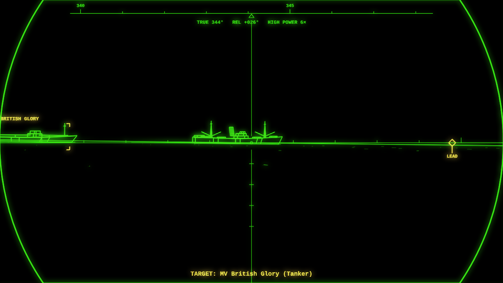

The periscope is your eye on the surface. It is drawn in the green vector style of the
1980 arcade game *Battlezone*: ships, waves, coastline and moon are all line drawings.

**When it works.** Submerged, the periscope works only when it is raised (**P**) and the
boat is at **periscope depth (13 m) or shallower**. Surfaced, you look from the bridge,
higher above the waves, whether the periscope is up or not. Below 16.5 m the periscope is under water and the view shows the sea around you
instead (see below). Raising takes about a second, lowering a little less.

**Training it.** **←** and **→** turn the periscope. It starts slowly and speeds up: a
short tap moves it a fraction of a degree (useful at high power to put the crosshair exactly
on a target), while holding the key brings it up to full speed in about a second. Hold
**SHIFT** for three times the full speed. It turns independently of the boat, so you can sail one way and look another.
**B** brings it back to the bow. **V** does the opposite: it orders the helmsman to steer
the boat onto the bearing the periscope is looking at. The periscope stays on that bearing
while the bow swings round, and the auto helm then holds the new course (see the helm,
section 4).

**Magnification.** **↓** is low power (1.5×, 48° field of view), good for searching. **↑**
is high power (6×, 12° field of view), good for identifying and aiming.

**What is on the glass:**

| Item | Meaning |
|---|---|
| Bearing tape (top) | True bearing of what you are looking at. The triangle marks the centre |
| TRUE / REL | True bearing of the periscope, and its bearing relative to the bow (+ = starboard) |
| Horizon line with ticks | Degree marks: every 5° at low power, every 1° at high power |
| Vertical line | The aiming line. Torpedoes run along the bearing under this line |
| Ticks below the centre | Stadimeter marks (2° apart at low power, 0.5° at high power) |
| Yellow brackets | The locked target and its name |
| Yellow diamond **LEAD** | Where to aim to hit the locked target (EASY and NORMAL only) |
| Red ship | An escort that has detected you |
| White dotted line on the water | The track of one of your torpedoes; close by you can see the torpedo itself, just under the surface |
| Red dotted line on the water | The track of an enemy torpedo (the torpedo itself in red when close) |
| Orange and yellow flames, grey smoke | A damaged, burning ship: it has been hit and will take another torpedo. Smoke drifts with the wind; steamers also trail funnel smoke |
| Yellow beam at night | An escort's searchlight sweeping for you |
| Cracks | Damage to the periscope glass from close explosions |

**Waves.** At periscope depth the sea moves the boat: now and then a wave washes over the
periscope and the view turns blue for a moment. In a storm this happens often.

**Speed.** Above about 4.5 knots submerged the periscope vibrates and the image shakes. It
also leaves a bigger wake on the surface, which escorts and aircraft can see.

**Messages.** The crew's reports appear in the lower part of the view and fade after a few
seconds: torpedo launches, hits, misses, alarms. The colour tells how urgent they are:
green is routine, yellow needs attention, red is danger, blue is good news about the boat.

### The underwater view

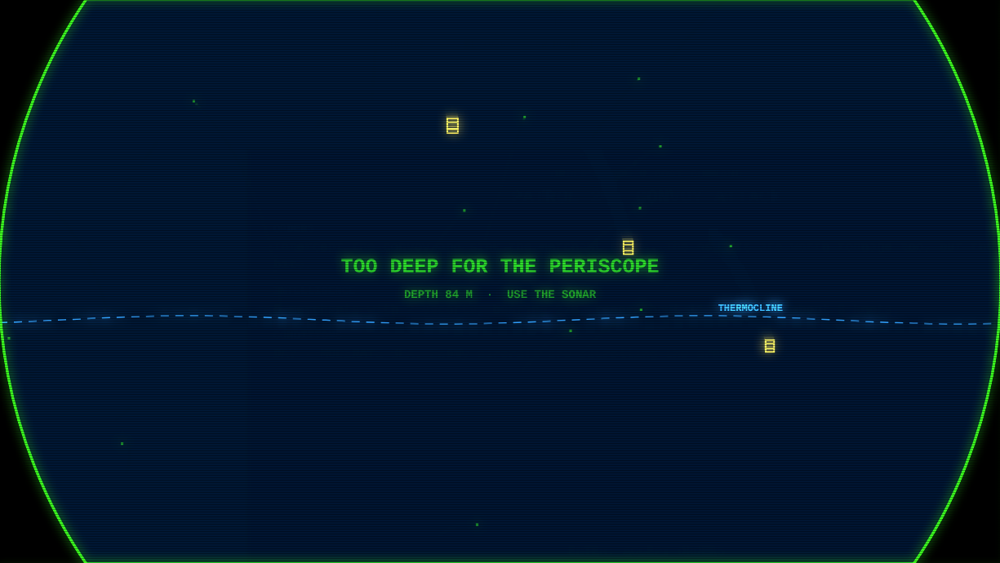

When the periscope cannot see, the view shows the water around the boat. It is not decoration:

- the **surface** shimmers overhead when you are shallower than about 50 m, with shafts of light;
- the **thermocline** appears as a dashed blue line when you are near 90 m;
- **depth charges** sinking near you appear as yellow barrels;
- **moored mines** appear as orange spheres with horns on a cable;
- **enemy torpedoes** passing overhead appear as red shapes;
- drifting particles stream past and show how fast you are moving.

---

## 4. Gauges and dials

From left to right:

**Depth gauge (DEPTH M).** 0 to 300 m. The green needle is the actual depth, the thin yellow
needle the **ordered depth**. The blue mark is the thermocline (90 m), the red zone the
danger area below 220 m. The readout shows *actual / ordered*. Order depths with **R**
(shallower) and **F** (deeper): surface, 13 (periscope depth), 20, 30, 40, 60, 80, 100,
120, 150, 180, 220, 260 m. The boat levels off at the ordered depth by itself.

**Speed dial (SPEED KN).** −8 to +20 knots. The yellow zone is going astern.

**Engine telegraph.** Seven positions, changed one at a time with **W** (ahead) and **S**
(astern): FULL ASTERN, HALF ASTERN, STOP, SLOW, HALF, FULL, FLANK. The lit sector is the
order; the white pointer shows how fast you actually go, because a big boat takes time to
respond. The readout also tells which engines are running: DIESEL on the surface, E-MOTOR
under water.

| Telegraph | Share of the maximum speed | Surfaced | Submerged |
|---|---|---|---|
| FULL ASTERN | −50% | −8.5 kn | −3.8 kn |
| HALF ASTERN | −25% | −4.3 kn | −1.9 kn |
| STOP | 0 | 0 | 0 |
| SLOW | 25% | 4.3 kn | 1.9 kn |
| HALF | 50% | 8.5 kn | 3.8 kn |
| FULL | 80% | 13.6 kn | 6.1 kn |
| FLANK | 100% | 17 kn | 7.6 kn |

**Compass (HEADING).** North-up. The white arrow is the boat's heading, the dotted yellow
line the direction the periscope is looking. The readout is the heading in degrees.

**Helm.** The upper bar shows the **rudder** (port to the left, starboard to the right, up to
30°). Hold **A** or **D** to put the rudder over; let go and it returns to midships. The
lower bar shows the **dive planes**: blue to the right when diving, green to the left when
rising, with the vertical speed. The readout is the rate of turn in degrees per second.
When the auto helm is steering (after **V**, or when the AI captain commands) the readout
turns blue and shows **AUTO HELM** with the ordered course; it turns the boat smoothly onto
that course and holds it. Touching **A** or **D** takes the wheel back.

**Battery, air and hull bars (BATT, AIR, HULL).** Each bar turns yellow below 40% and red
below 20%.

- **BATT** drains while submerged, faster the faster you go, and recharges on the surface.
- **AIR** drains while submerged and refills quickly on the surface. At zero the crew
  suffocates slowly: the hull bar falls.
- **HULL** is the boat's strength. At zero the boat is lost.

---

## 5. Sonar

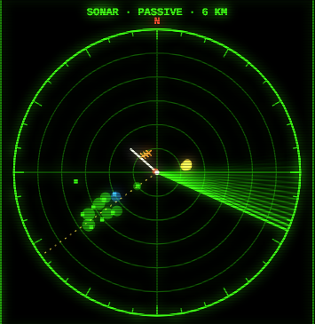

The round scope shows a 6 km circle around the boat, **north up**. The rings are 1 km apart,
and the rim carries a bearing scale (every 5°, numbered every 30°). The white line from the
centre and the white triangle outside the rim mark your heading; the dotted yellow line is
the periscope bearing, so you can turn the periscope onto a sonar contact. Under the scope,
**HDG** is your heading and **SCOPE** the periscope bearing in degrees; when the AI captain
or the first officer is on, a dashed blue line and the blue **→** figure show the course
they recommend.

**Passive listening** is always on. The bright beam sweeps round once every three seconds;
when it passes a sound source, a blip lights up and fades before the next sweep. Passive
blips are **approximate**: the further and quieter the source, the more the blip wanders.
How far you can hear something depends on how loud it is:

| Source | Heard up to about |
|---|---|
| Merchant ship at convoy speed | 7 km |
| Escort at attack speed | 7 km |
| Torpedo running | 6 km |
| Depth charge sinking | 5 km |
| Submarine at periscope depth, slow | 3 km |
| Moored mine | 0.4 km |

Your own noise deafens you: above 6 knots, or surfaced, you hear only 60% as far; in a
storm, 70%. A contact beyond 6 km shows as a short mark on the rim at its bearing.

**Active ping (TAB).** A white ring expands to 6 km in a second and a half. Every contact it
reaches is painted as an **exact square blip** that stays for ten seconds, and moored mines
within 3 km show up as well. The price: **every enemy within 9 km hears it** and learns
roughly where you are. The sonar needs four seconds between pings.

**Colours:**

| Blip | Meaning |
|---|---|
| Green | Surface ship |
| Blue | Submerged submarine |
| Red torpedo shape | Enemy torpedo, pointing along its course |
| White torpedo shape | One of your torpedoes |
| Yellow | Depth charge |
| Orange × | Mine |
| Yellow ring | The locked target |

---

## 6. Torpedo tubes and the torpedo data computer

### Tubes

Five lamps, one per tube: **1-4** in the bow, **5 AFT** in the stern. Select a tube with the
number keys; the white frame shows the selected one.

| Lamp | Meaning |
|---|---|
| Green, filled | Loaded and ready |
| Yellow ring with a growing arc | Reloading (about 11 seconds) |
| Red | Empty, nothing left in reserve |

**RESERVE** counts the spare torpedoes. An empty tube reloads by itself while the reserve
lasts. After you fire a bow tube, the next loaded bow tube is selected automatically.

Under the lamps:

- **GYRO**: the course the next torpedo will take (normally the periscope bearing);
- **IN ARC / OUT OF ARC**: bow tubes can fire up to 90° either side of the bow, the stern
  tube up to 90° either side of the stern;
- **DEPTH OK / TOO DEEP**: torpedoes can be fired only at 25 m or shallower.

### Torpedoes

| | |
|---|---|
| Speed | 40 knots (about 2 km in 24 seconds) |
| Range | 6 km |
| Arming distance | 250 m: closer than that, they bounce off |
| Guidance | Gyroscope: they turn onto the gyro course after launch, then run straight |
| Running depth | Shallow: they pass over a submarine deeper than 15 m |
| Reliability | Some are duds (8% on EASY, 12% NORMAL, 15% HARD) |
| Warhead | One hit sinks most ships; big cargo steamers (over 6,200 GRT) and tankers need two |

### Torpedo data computer (TDC)

Aim at a ship through the periscope and press **T** to lock it: it must be near the centre
of the view (within about 10° at low power, 2.5° at high power). Press **T** again to release
it. The TDC then shows:

| Line | Meaning |
|---|---|
| Name and tonnage | The target and what it is worth |
| RANGE | Distance (estimated, see difficulty) |
| SPEED / COURSE | The target's speed and course (estimated) |
| AOB | Angle on the bow: how the target shows its side to you, with S or P for starboard or port |
| LEAD | Course to fire on, and the lead angle relative to the target's bearing |
| RUN | How long the torpedo will take to get there, in seconds |
| SOLUTION OK / STALE | STALE means the target has not been observed for a while: look at it again |

The TDC only learns from what the periscope sees. When the periscope is down or the target
out of sight, it keeps working on the last observation and the solution goes stale.

---

## 7. Status lamps

Sixteen lamps under the tubes. A lit lamp is filled with its colour; blinking lamps need
action.

| Lamp | Colour | Lit when |
|---|---|---|
| SURFACED | green | The boat is on the surface |
| PERISCOPE | green | The periscope is up and can see |
| SILENT | blue | Silent running is on (**X**) |
| DETECTED | red, blinking | At least one enemy has contact with you |
| ASDIC | yellow, blinking | An escort's sonar ping has just been heard within 2.5 km |
| DIESEL | yellow | Running on the diesels (surfaced) |
| BELOW LAYER | blue | Deeper than the thermocline (90 m) |
| CRASH DIVE | red, blinking | A crash dive is in progress |
| AIR LOW | yellow, then red | Air below 25% (red and blinking below 10%) |
| BATT LOW | yellow, then red | Battery below 25% (red and blinking below 10%) |
| HULL CRIT | red, blinking | Hull below 30% |
| DEPTH CRIT | red, blinking | Deeper than 220 m: the hull is giving |
| TORPEDO | red, blinking | An enemy torpedo within 3 km is heading your way |
| AIRCRAFT | red, blinking | An aircraft within 6 km while you are at periscope depth or on the surface |
| MINES | orange, blinking | A mine within about 600 m |
| NIGHT | blue | It is night |

---

## 8. How the boat moves

The boat is big and heavy; every order takes time.

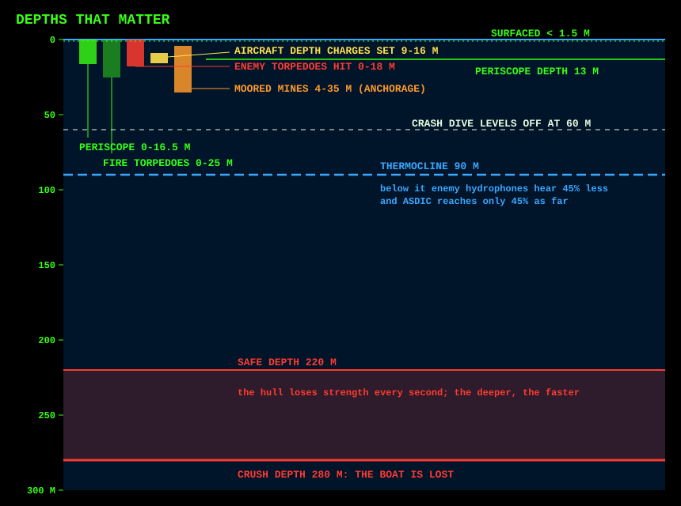

**Speed.** The boat gets most of the way to a new speed in about 8 seconds and settles in
about 20. Stopping takes as long as accelerating.

**Turning.** The rudder moves at 30° per second while **A** or **D** is held and returns to
midships when you let go. The boat turns on a circle of about 190 m at full rudder, so the
faster it goes, the faster it turns: about 5° per second at full submerged speed, 11° per
second at full surfaced speed. It does not turn at all when stopped. The swing builds up and
dies away gradually, so start a turn early and centre the rudder before the bow reaches the
new heading.

**Diving and surfacing.** The dive planes need water flowing past them: the faster you go,
the faster you change depth (up to about 6 m/s at full submerged speed, under 2 m/s when
stopped). Blowing the tanks to rise always works, even when stopped. **C** is a crash dive:
the periscope comes down, the engines go to FULL, the boat dives at about 10 m/s and levels
off at 60 m (or at the ordered depth if it is deeper). It is fast, but very noisy.

**Battery.** Submerged, the battery lasts:

| Speed | Battery lasts |
|---|---|
| FLANK (7.6 kn) | about 6 minutes |
| FULL (6.1 kn) | about 9 minutes |
| HALF (3.8 kn) | about 20 minutes |
| Silent (2.5 kn) | about 40 minutes |

With a flat battery the boat cannot move under water, but it can still blow its tanks and
surface. On the surface the diesels recharge a flat battery in about 3.5 minutes (much more
slowly at FLANK).

**Air.** A full charge of air lasts about 12 minutes submerged; it refills in about 13
seconds on the surface.

**Noise.** Everything you do makes noise, and the escorts listen:

| Source | Noise |
|---|---|
| Speed | Grows quickly with speed |
| Diesels (surfaced) | A lot |
| Crash dive | A lot, while it lasts |
| Torpedo launch | A burst |
| Active ping | A big burst |
| Silent running | Cuts the noise of the engines by more than half |

Bursts die away over a few seconds.

---

## 9. How the enemy finds you

Each enemy builds up **contact** over a few seconds from what it sees and hears, and loses
it when the signals stop. When an escort has contact it turns **red** in the periscope and
the **DETECTED** lamp blinks.

### Escorts (corvettes and destroyers)

| Sense | Range (day, moderate sea) | Notes |
|---|---|---|
| Lookouts, boat surfaced | 5 km | Shorter at dusk, at night, in fog and in a storm |
| Lookouts, periscope up | 0.9 km + 0.12 km per knot | Halved in a storm (spray hides the periscope) |
| Hydrophones | 0.3 km + up to 3.2 km with your noise | Mostly deaf while the escort runs above 20 knots; 45% less below the thermocline |
| ASDIC (active sonar) | 1.8 km, submerged boat only | 45% as far below the thermocline; much weaker while the escort runs above 22 knots |

When an escort pings within 4 km you hear it through the hull, and you also see it: the
**ASDIC** lamp lights for a few seconds, a yellow flash and a dotted ray on the sonar rim show
the bearing of the escort that pinged, and the crew reports *"ASDIC PINGS BEARING 057°"*
(at most every 30 seconds).

ASDIC has two weaknesses. It **loses a deep boat in the last stretch** before the escort runs
over it (the deeper you are, the further out it goes blind), which is why the escorts drop
their charges by estimate. And the **water churned up by exploding depth charges** blinds
ASDIC and hydrophones for about 15 seconds around the explosions: the moment to sprint
away.

Convoy escorts cannot stray far: one that has chased you about 4.5 km from its place in the
screen gives up and goes back to the convoy.

You can hear their ASDIC: a lower, duller ping than yours. The **ASDIC** lamp blinks when one
comes from within 2.5 km.

When an escort gains contact, the escorts near it join the hunt. An escort that has lost you
goes to your last known position and circles it; after a while it gives up and returns to
its station.

### Enemy submarines

A submarine has good hydrophones: 0.6 km plus up to 6 km with your noise (less while it is
itself on the surface). At periscope depth or surfaced it can also see you: a surfaced
U-boat at 4.5 km, a periscope at about a kilometre. Deep, it can only listen.

### Aircraft

| Your boat | Spotted from |
|---|---|
| Surfaced | 6 km |
| Periscope up | 0.3 km + 0.15 km per knot (the wake) |
| Under 25 m deep, by day, in calm or moderate sea | 0.25 km (a shadow in the water) |
| Deeper | Not at all |

All these ranges shrink with the conditions (see [section 14](#14-time-of-day-sea-and-fog)).

---

## 10. The torpedo attack

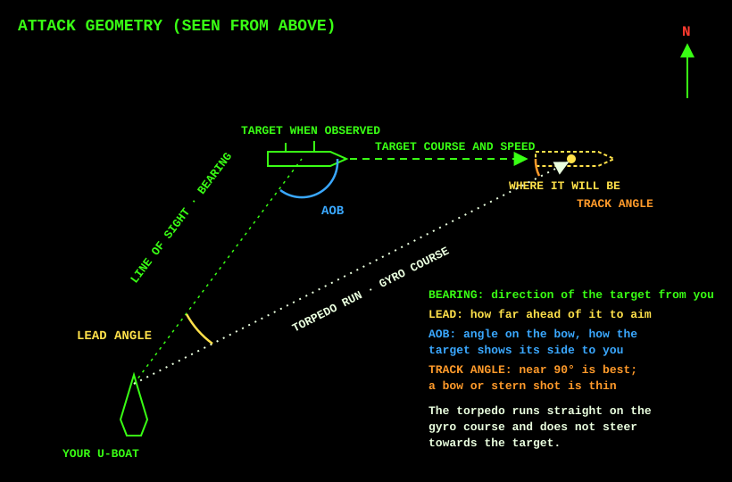

A torpedo does not chase its target: it runs straight on its gyro course. Fired straight at
a moving ship, it arrives where the ship *was*. You must aim where the ship *will be*.

**The procedure:**

1. **Find the target.** Listen on the sonar, then turn the periscope onto the bearing (the
   dotted yellow line on the sonar shows where the periscope points).
2. **Get into position.** The best position is ahead of the target and off to one side, so
   that it will cross in front of you at 1 to 2 km. Approach at periscope depth, slowly,
   raising the periscope only to look.
3. **Identify and lock.** Switch to high power (**↑**), put the ship under the vertical line
   and press **T**. Check the TDC: range, speed, course and angle on the bow.
4. **Aim.** Train the periscope onto the yellow **LEAD** diamond. The GYRO readout under the
   tubes must say IN ARC and DEPTH OK.
5. **Fire.** **SPACE** fires the selected tube. For a better chance, fire a spread: fire,
   train the periscope a degree or two, fire again.
6. **Watch and leave.** The RUN time tells you when to expect the hit. Then lower the
   periscope and go deep before the escorts arrive.

**Good shots and bad shots:**

- The best **track angle** is near 90°: the torpedo meets the ship's whole side. A shot at
  the bow or stern has only the ship's narrow beam to hit.
- Long shots give the target time to zigzag: a convoy changes course every minute or two,
  and an alerted one zigzags more often and speeds up. Under 2 km is a good range.
- Closer than 250 m, the torpedo has not armed yet and bounces off.
- The TDC's numbers are estimates (except on EASY): a stale or rough solution misses.
- The LEAD already allows for the curve the torpedo makes as it leaves the tube and turns
  onto its gyro course, so it is right at large gyro angles too.

**Difficulty and aiming:**

| | EASY | NORMAL | HARD |
|---|---|---|---|
| LEAD marker | yes | yes | no |
| Firing with a lock | uses the solution by itself, wherever the periscope points | fires along the periscope | fires along the periscope |
| Error in observed speed | none | up to ±15% | up to ±25% |
| Error in observed range | none | up to ±6% | up to ±10% |

On HARD you aim by hand: the TDC still gives range, speed, course, AOB and run time.

---

## 11. The enemy

| Type | Length | Worth | Speed | Torpedoes to sink | Behaviour |
|---|---|---|---|---|---|
| Cargo steamer | 125 m | 4,000-7,500 GRT | 11 kn | 1 (2 over 6,200 GRT) | Keeps station in the convoy; slows to a crawl when damaged |
| Tanker | 145 m | 8,000-11,000 GRT | 11 kn | 2 | Burns when hit and explodes as it sinks |
| Flower-class corvette | 62 m | 925 t | 16 kn | 1 | Slow but persistent escort, 40 depth charges |
| V&W-class destroyer | 95 m | 1,300 t | 34 kn | 1 | Fast escort, attacks at 26 knots, 30 depth charges |
| T-class submarine | 84 m | 1,090 t | 15 kn surfaced, 9 kn submerged | 1, only at periscope depth or surfaced | Hunts you, fires salvos of three torpedoes |
| Sunderland flying boat | | | 150 kn | cannot be hit | Patrol aircraft, 6 depth charges |
| Hudson patrol bomber | | | 190 kn | cannot be hit | Patrol aircraft, 4 depth charges |

Merchants are counted in gross register tons (GRT), warships and submarines by
displacement (tons). Both count towards the score.

### Escorts

Escorts weave around their station on the convoy, pinging every few seconds. With
contact they run at the position where they think you are and roll a pattern of **five
depth charges** as they pass over: three from the stern rails and two thrown 45 m to the
sides. The charges are set to the depth they believe you are at. Then they run on, turn
and come back for another run about 20 seconds later.

If you are **surfaced** and an escort has you in sight within 6 km, it opens fire with its
guns. After dark, escorts that have you sweep the sea with **searchlights**.

### Enemy submarines

By day an enemy submarine patrols at periscope depth, where only its periscope and a thin
feather of wake show. At night it runs on the surface to charge its batteries. When it has
contact it closes to about 2.6 km, turns its bow onto a firing solution and fires **three
torpedoes** in a narrow spread. Then it dives to 50 m and turns away; it can fire again
about 40 seconds later.

It can hear your torpedoes coming within about 1.2 km and sometimes (almost half the time)
it goes deep a moment later, and your torpedoes then pass over it.

Its torpedoes run at 45 knots for 5 km, **shallow**: deeper than 18 m they pass over you.
When one is fired within 5 km of you, the crew reports *TORPEDOES IN THE WATER* with the
bearing, the alarm sounds, the **TORPEDO** lamp blinks and you can hear the propellers
whining as they come.

### Aircraft

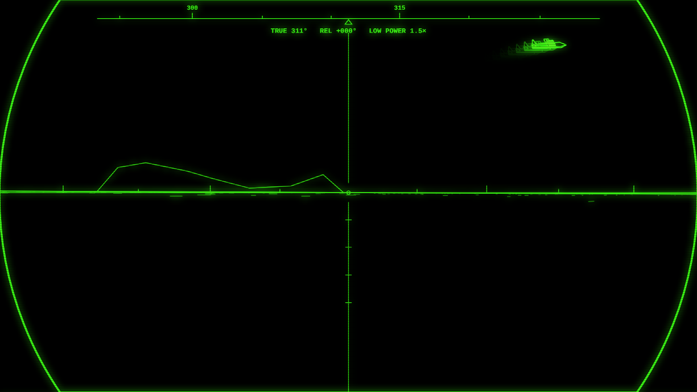

Aircraft patrol by day and at dusk, never at night, in a storm or in fog. One appears every
minute and a half or two. When it spots you it dives to 40 m above the sea and drops its
depth charges, set **shallow (9-16 m)** and smaller than an escort's, across your position. While it can still see you it
corrects its run; once you are deep it aims at the swirl where you dived. Surfaced, your
lookouts report aircraft within 7 km: *AIRCRAFT BEARING ... DIVE!* You will also hear the
engines.

---

## 12. Dangers

| Danger | Damage | How to avoid it |
|---|---|---|
| Depth charge | Up to 55% at point-blank range, nothing beyond 85 m | Change depth and turn hard when they splash; go below the thermocline |
| Aircraft depth charges | Up to 50% at point-blank range, nothing beyond 45 m; set at 9-16 m | Be at 60 m or deeper when they arrive: a crash dive takes you there |
| Gunfire | 10% per hit | Dive |
| Enemy torpedo | 75% | Go deeper than 18 m, or turn to present your narrow end |
| Mine | 80% | Pass deeper than 45 m, or find the swept channel |
| Below 220 m | Continuous, faster the deeper | Come up |
| 280 m | The boat is crushed | Never go there |
| No air | Slow, continuous | Surface before the air runs out |

These figures are for NORMAL. EASY takes 60% of the damage, HARD 130%.

A depth charge within 85 m in three dimensions does damage: one exploding 40 m directly
above or below you is as dangerous as one 40 m to the side. That is why changing depth
works as well as turning away.

Damage is permanent until the end of the patrol: each completed patrol patches the hull by
25%.

---

## 13. Missions

Every patrol starts with **orders** on screen: the mission, the intelligence (bearing and
range of the enemy) and the conditions. Press **ENTER** to accept and start. The bottom of
the right panel always shows the mission, its progress and the conditions.

The first five patrols follow a fixed order; after that the mission is drawn at random
(convoys twice as often as the others).

| Patrol | Mission | Goal | Ends badly when |
|---|---|---|---|
| 1, 3 | **Convoy attack** | Sink all the merchants | The convoy gets 15 km away from you |
| 2 | **Submarine duel** | Sink the enemy submarine (two from patrol 7) | It gets 20 km away |
| 4 | **Escape the hunters** | Survive 6 minutes, or sink every hunter | |
| 5 | **Anchorage raid** | Sink the ships at anchor behind a minefield | You go 16 km away from the anchorage |

**Convoy attack.** 4 merchants and 1 escort on patrol 1; each patrol adds a merchant (up to
10) and every second patrol another escort (up to 5). The convoy starts 9 to 11 km away,
heading roughly your way, at 7 to 9.4 knots, and zigzags. Air cover from patrol 2, if the
weather allows.

**Submarine duel.** An enemy submarine is 6 to 8 km away and has been told roughly where
you are, too. It keeps getting new rough fixes on you, so hiding forever does not work. Who
hears whom first decides the fight.

**Escape the hunters.** A hunter-killer group of three escorts (more in later patrols)
starts 3 to 5 km away and closes in on your rough position. Survive 6 minutes for a
**3,000 point bonus**, or sink them all. Air cover if the weather allows.

**Anchorage raid.** Four to seven merchants lie at anchor 8 to 9 km away, guarded by two
corvettes (a destroyer joins from patrol 8) circling 1.5 km out. Two rings of moored mines
surround the anchorage about 3 km out, with one swept channel through them. Mines are
moored between 4 and 35 m. Ping to see them, or go under them. Air cover if the weather
allows.

When a mission ends, the boat sails for 7 seconds, then it is resupplied (up to 7 torpedoes
back into the reserve, hull patched by 25%) and the next patrol's orders arrive.

---

## 14. Time of day, sea and fog

The first patrol is always by day in a moderate sea. After that, each patrol rolls its own
conditions.

| Condition | Chance | Effect on sight (both ways) | Other effects |
|---|---|---|---|
| Day | 45% | 100% | Aircraft fly |
| Dusk | 25% | 70% | Aircraft fly; escorts use searchlights |
| Night | 30% | 40% | No aircraft; escorts use searchlights; enemy submarines surface |
| Calm sea | 30% | | Small waves |
| Moderate sea | 50% | | |
| Storm | 20% | 80% | Big waves wash over the periscope often; a periscope is hard to spot; everyone hears 30% less; no aircraft |
| Fog | 15% (never in a storm) | 35% | No aircraft |

"Sight both ways" means the range at which you can see ships through the periscope *and*
the range at which escorts, submarines and aircraft can see you. Night and fog favour the
attacker: a surfaced attack at night, at speed, was how the real U-boats fought convoys.

---

## 15. Patrols, score and difficulty

**Score** = tonnage sunk (GRT and tons) + mission bonuses. It is shown in yellow at the
bottom right. The five best scores are kept in the browser, with the patrol reached, the
difficulty and the date. **I** shows the statistics of the current game: ships sunk by
type, torpedoes fired, hits, duds and misses, depth charges and air attacks survived,
torpedoes and mines that hit you, the deepest dive, time submerged and missions
accomplished.

**Difficulty** is chosen on the title screen (**1**, **2**, **3**):

| | EASY | NORMAL | HARD |
|---|---|---|---|
| LEAD marker | yes | yes | no |
| Gyro from the solution | automatic | by hand | by hand |
| TDC errors | none | small | larger |
| Damage taken | 60% | 100% | 130% |
| Enemy senses | 70% | 100% | 130% |
| Duds | 8% | 12% | 15% |

The game ends when the hull reaches zero, or when you abandon the patrol (**ESC**, then
**Q**). **ENTER** starts a new game, **ESC** goes back to the title screen.

**Screen effects.** **G** switches the CRT look (phosphor glow, persistence, scanlines) on
and off. If the computer cannot keep a smooth frame rate, the game turns the effects off by
itself and tells you. **M** switches the sound on and off. All sounds are generated by the
browser; they start after the first key press.

---

## 16. Tactics

- **Run on the surface, fight submerged.** The diesels are more than twice as fast and fill
  the battery. Close in on the surface while you are far away (more than 6 km by day), then
  dive to periscope depth for the attack.
- **Use the periscope sparingly** when escorts are near: raise it, look, lower it.
- **Slow is quiet.** At SLOW or in silent running the escorts' hydrophones have to be right
  on top of you.
- **When you hear DEPTH CHARGES IN THE WATER:** change depth by 30 m or more and turn hard.
  The pattern is set to where they think you are.
- **Below the thermocline** (90 m) the escorts' sonar is much weaker. Get there, slow down,
  and wait for them to lose you.
- **Don't ping near escorts.** A ping tells every escort within 9 km where you are. Use it
  to find a quiet target, a submarine or a minefield.
- **Night attacks.** At night you can approach on the surface, fast, almost unseen. Watch
  for searchlights: an escort that has you will light you up.
- **Aircraft:** when the lookouts shout, crash dive (**C**) at once. Aircraft charges are
  set shallow; at 60 m, where a crash dive levels off, they cannot reach you.
- **Enemy submarines:** stay deeper than 18 m when you are not attacking. Approach slowly
  and fire before it hears you. If you hear *TORPEDOES IN THE WATER*, dive.
- **Minefields:** ping from outside the field to see the mines and the gap in them, or
  cross deeper than 45 m.
- **Mind the battery and the air** after a long chase: you need both to get home.
- **When an escort comes close, go under the layer before it finds you,** and come back up
  when it has passed. Above the layer its ASDIC builds contact inside about 1.4 km.
- **After a pattern, run.** The churned water hides you for a few seconds: go to full speed
  across the escort's track, change depth, then slow down and go silent again.
- **Wait for a good angle on the bow.** A ship coming straight at you, or going away, is a
  narrow target; let it turn its side to you (AOB 40° to 145°).

---

## 17. Quick reference

| Key | Command |
|---|---|
| W / S | Engine telegraph ahead / astern |
| A / D | Rudder to port / starboard (hold) |
| R / F | Order a shallower / deeper depth |
| C | Crash dive |
| P | Raise / lower the periscope |
| ← / → | Train the periscope: a tap for fine moves, hold to speed up (SHIFT = faster) |
| ↑ / ↓ | Periscope high / low power |
| B | Periscope to the bow |
| V | Steer to the periscope bearing (auto helm) |
| T | Lock / release the target in the crosshair |
| SPACE | Fire the selected tube |
| 1 - 5 | Select a tube (5 = stern) |
| TAB | Active sonar ping |
| X | Silent running |
| H | Help |
| I | Patrol statistics |
| M | Sound on / off |
| G | CRT effects: FULL → MEDIUM → LOW → OFF |
| K | AI captain takes / gives back command (demo) |
| O | First officer's guidance on / off |
| + / - | Text size (75% to 125%) |
| N | Blueprints |
| E | Deck gun |
| L | Chart (↑/↓ scale) |
| ENTER | Accept the orders / start a new game |
| ESC | Pause (then Q to abandon the patrol) |

---

## 18. The AI captain and the first officer

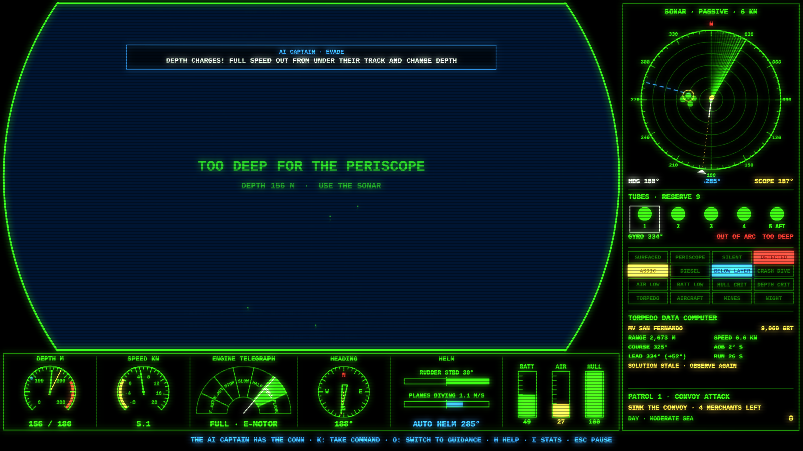

Two crew members can help you learn the boat. Both are offered on the title screen, on
every set of orders, and with a key at any time during a patrol.

**The AI captain (K): demo mode.** The AI captain takes command and carries out the mission
by himself, with the same commands you have. You watch: a blue box at the top of the
periscope tells you what he is doing and why ("ESCORT CLOSING · UNDER THE LAYER UNTIL IT HAS
PASSED", "ON THE LEAD · TUBE 2 · GYRO 047°"), the sonar shows his chosen course in blue,
and the helm shows AUTO HELM. While he has the conn your keys for the boat do nothing;
**K** again gives you command back at once, wherever you are. While nothing much is
happening (the approach, the long wait below the layer) the demo runs time three or four
times faster, shown as **TIME ×3** or **×4** in the box. In demo mode the orders of each
new patrol are accepted after six seconds. A patrol in which the AI captain commanded is
not entered in the high scores.

What he does, roughly in order of priority:

1. Aircraft about: crash dive to 60 m and stay there, below their charges.
2. Torpedoes coming: go below 18 m.
3. An escort has contact, or charges are falling: go below the layer, slow and silent; when
   a pattern comes down, sprint out from under the escort's track and change depth.
4. Battery or air low and nobody near: surface and recharge.
5. Otherwise attack: a surface run on the diesels while the escorts are out of sight, then
   periscope depth, a position ahead of the target and about 2 km off its track, slow and
   silent; lock, wait for a broad angle on the bow, fire a fanned spread from about 2.4 km.
   Escorts coming close send him under the layer until they have passed.

He is a good captain, not a perfect one: on NORMAL and HARD he aims with the same inexact
TDC data you get, so he misses too, and escorts sometimes hold on to him.

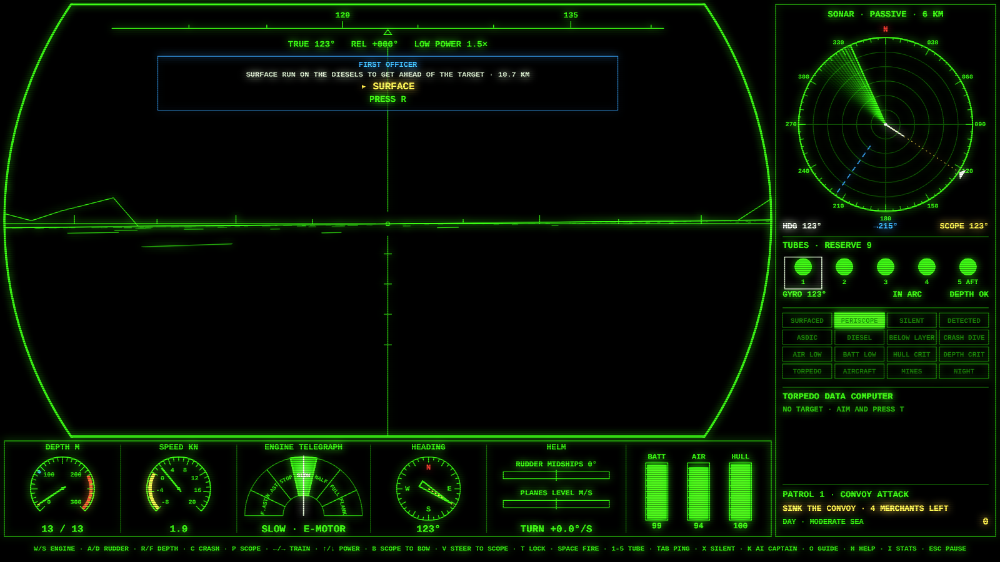

**The first officer (O): guided mode.** You keep command; the first officer looks at the
situation the same way the AI captain does and tells you **one thing to do next**, with the
reason and the keys: for example *"▸ ORDER DEPTH 100 M · PRESS F ×3"*. When you have done
it, a green tick confirms it and the next step appears. **O** again sends him away. Patrols
sailed with guidance are recorded in the high scores marked GUIDED.

## 19. Screen and text size

The text and the panels grow with the window, so a 4K monitor gets 4K-sized lettering.
**+** and **-** make all the text larger or smaller in 5% steps, from 75% to 125% of that
size; the setting is kept in the browser for next time.

## 20. Blueprints

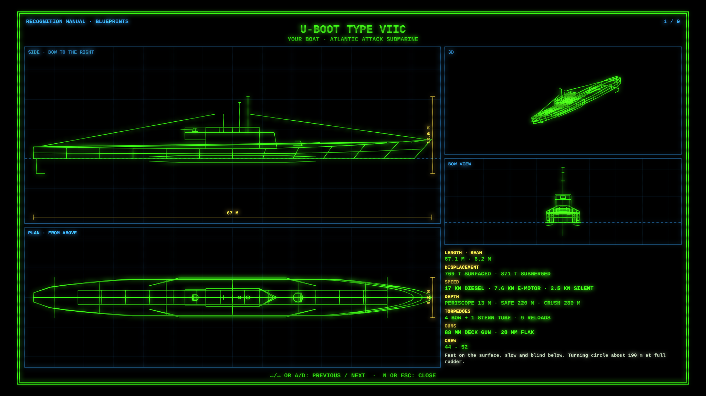

**N** opens the recognition manual, on the title screen or during a patrol (the game pauses).
It has a sheet for your own Type VIIC, the cargo steamer, the tanker, the Flower-class
corvette, the V&W-class destroyer, the T-class submarine, the Sunderland and the Hudson,
and the G7 torpedo. **←/→** (or **A/D**) turn the pages; **N** or **ESC** closes it.

Each sheet shows the same wireframe the periscope draws, as:

- a **side elevation** (bow to the right) with the waterline dashed in blue, and the length
  and height in yellow;
- a **plan** from above, at the same scale, with the beam (or the wingspan);
- a **front view** and a slowly turning **3D view**;
- the data that matter in the game (size, tonnage, speed, weapons, how many hits it takes)
  and what to look for to recognise it.

The grid is 5 m (1 m for the torpedo). The torpedo is drawn twice life size in the periscope;
its sheet gives the real dimensions.

## 21. The deck gun

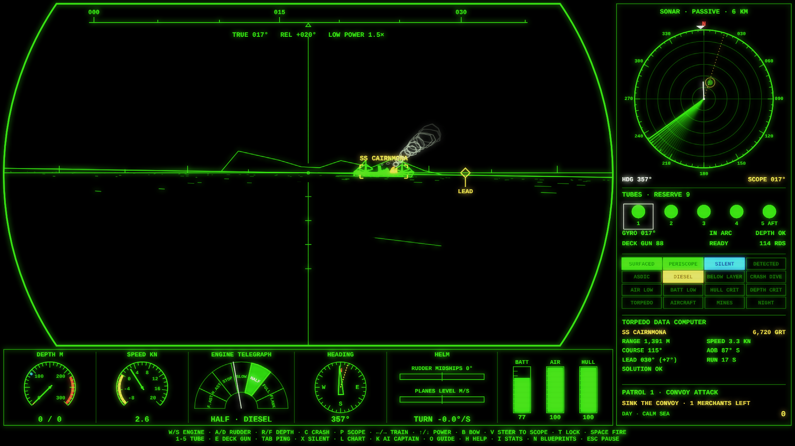

The Type VIIC carries an 88 mm gun forward of the conning tower. **E** fires one round at
the **locked target** (lock it first with **T**). The right panel shows the gun's state
under the tubes: **SUBMERGED**, **MANNING** (with the seconds left), **LOADING**, **READY**,
and the rounds left.

- Surfaced only, and not in a storm: the crew needs about **8 seconds** after surfacing to
  clear the gun away.
- Range **4 km**; a round flies about 750 m a second. One round every 1.25 seconds.
- The chance of a hit is good close in and poor at long range, lower against a small or
  fast target, at night, in fog or in a moderate sea, and while your own boat is moving
  fast. It improves as the gun layer walks his fire onto the same target.
- A cargo steamer takes 5 to 12 hits, a tanker up to 16, an escort about 5. A ship already
  hit by a torpedo needs far fewer: the gun is for **finishing off stragglers**.
- 120 rounds, 60 more at each resupply.
- **The bang carries.** Every escort within 9 km comes to look, and the convoy scatters.
  Use the gun only when no escort is in sight, and dive the moment one shows up.

The AI captain uses it the same way: he surfaces to finish a damaged merchant, or when his
torpedoes are gone, but only with every escort more than 7 km away.

## 22. The chart

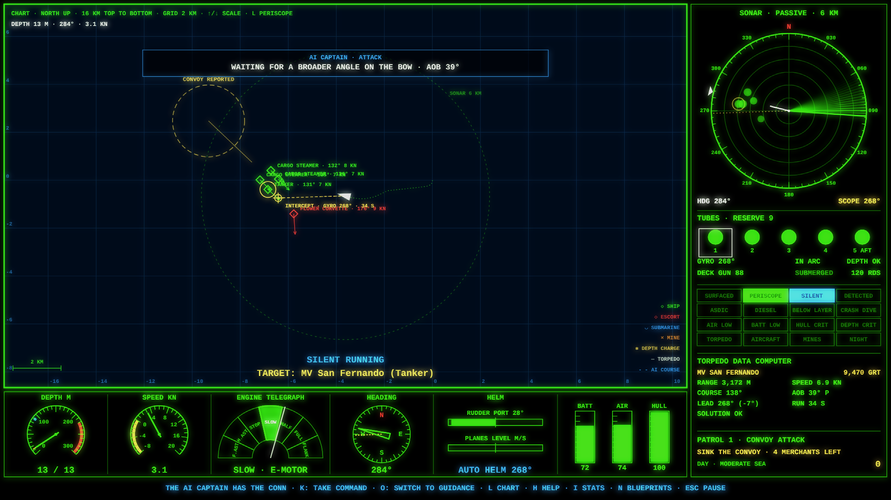

**L** replaces the periscope view with the navigation chart (and back). The boat carries on
as before. The chart is **north up**, centred on the boat, with a km grid (labelled from
where the patrol began); **↑/↓** change the scale from 4 to 32 km top to bottom.

The chart shows only what the boat knows:

| Mark | Meaning |
|---|---|
| White triangle, dotted line | Your boat and its track; dotted yellow: the periscope bearing |
| Green ◇ | A ship reported by the lookouts or the periscope (named) or heard on sonar (CONTACT n) |
| Red ◇ | An escort |
| Blue half-circle | A submarine |
| Arrow from a contact | Its estimated course and speed: where it will be in 3 minutes. The estimate needs about 40 seconds of reports and gets better with more |
| × | A sunk ship; orange × a mine found by a ping |
| Yellow ✱ | A depth-charge explosion (fades in 4 minutes) |
| Yellow dashed circle | What U-boat command reported in the orders (with the convoy's course); orange dotted rings: a reported minefield |
| White line | Your torpedoes running |
| Yellow dashed line and ⊕ | The TDC's firing solution: gyro course and intercept point, with the run time |
| Blue dashed line, blue circle | The AI captain's (or first officer's) course and aim point |
| Dashed rings | Sonar range (6 km) and, surfaced, gun range (4 km) |

## 23. What you hear

All the sounds are synthesized. Besides the ones of earlier versions (pings, ASDIC, depth
charges, torpedoes, aircraft), v1.4 adds:

- **Escort propellers**: a beating thrum that grows as an escort closes on you while you are
  submerged, loudest when it runs overhead, its pitch falling as it passes (Doppler).
- **Depth-charge pistols**: a sharp double click just before a close charge goes off.
- **The hull in silent running**: below 40 m, quiet groans of the pressure hull and the odd
  drip, more often the deeper you are.
- **The deck gun**: crack, thump and an echo across the water; a dull boom for each hit.

## 24. Date, place, sky, underwater light, sea life and the CRT effects

**Date, place and clock.** Every patrol has a date and a place. The career begins in early
March 1941 and each patrol is about five weeks after the last. The places are real: open-ocean
areas (Western Approaches, Rockall Bank, south of Iceland, the Greenland gap, the Grand Banks,
Biscay, the Azores, off Freetown) and, for the anchorage raids, Loch Ewe, Scapa Flow,
Hvalfjordur and Freetown roads. The orders give the date, the ship's time and the position;
the panel shows the area and position under the patrol's name. At the bottom right, a
split-flap calendar shows the date (its leaves flip when it changes), and below it an analog
clock shows ship's time (local time) with the sun, the setting sun or the moon on its face.
The clock runs with game time: one game minute every 15 seconds.

**The sky.** The sun and the moon are where they would really be on that date, at that time
and in that place, and the moon shows its real phase. Each patrol starts at a time of day
that fits its conditions: the sun high by day, low in the west at dusk, well below the horizon
at night (in high summer at high latitudes it never gets fully dark: you get the darkest hour).
By day the sun is usually above the periscope's field of view; train the periscope on its
bearing at dawn or dusk to see it. The moonlight glitter on the water is under the moon, and
only when the moon is up; the underwater light shafts lean away from the sun.

**Under water.** Just below periscope depth you look up at the underside of the waves. Their
ripples are fixed to the compass, so they turn with the periscope. By day the surface throws
a shimmering net of light (caustics) and shafts of sunlight down into the water; they lean
away from the sun, fade with depth and are gone at night.

**Sea life.** Below periscope depth, schools of fish swim at their own depths (between about
10 and 140 m) and dart away from the hull when the boat comes close. On the surface, by day in
a calm or moderate sea, pods of dolphins leap and blow near the boat; the high-power periscope
shows them best. Neither has any effect on the game.

**The CRT effects (G)** step through four levels:

| Level | Glow | Phosphor persistence | Scanlines |
|---|---|---|---|
| FULL | strong | long trails | full |
| MEDIUM | softer | short trails | lighter |
| LOW | faint | none | faint |
| OFF | none | none | none |

On a slow machine the game switches them off by itself after a few seconds of low frame rate;
G turns them back on.

## 25. Progress in the address bar

The game keeps your **best score** and the **highest patrol you have completed** in the page
address, after a `#`:

    uboot-zone.html#best=12345&patrol=3

It is updated every time you complete a patrol and when a game ends. Bookmark the page (or
copy the link) to keep your progress, or send it to someone. When the page opens with such
an address, the title screen shows the best score and the patrols completed, and **C**
continues the career at the next patrol (with its date, five weeks or so later). Patrols in
which the AI captain commanded do not count. The high-score table (stats screen) is kept in
the browser as before.
