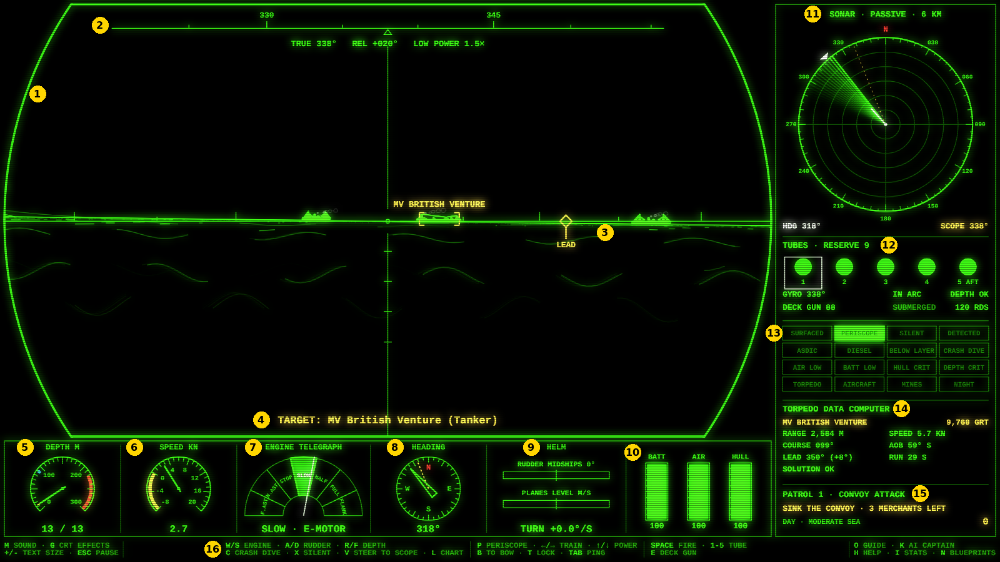

# U-Boot Zone

A single-file, no-dependency HTML5 arcade game in the green-on-black vector style of
Atari's 1980 *Battlezone*. You command a 1940 U-boat: you see the sea through the
periscope, find the enemy with the sonar, and read the state of the boat from dials,
gauges and lamps.

**[▶ Play it online](https://droogia.github.io/uboot-zone/)**, or open `uboot-zone.html`
in a browser and play. Everything runs locally; nothing is downloaded and nothing is
uploaded.

The **[Commander's Manual](MANUAL.md)** explains every instrument, the game dynamics and the
tactics, with screenshots and diagrams.



It is an arcade game, not a simulation. Time runs four times faster than real time,
and the physics is simplified, but the boat still behaves like a big vessel: it
accelerates, turns and dives slowly.

## Screen

| Area | What it shows |
|---|---|
| Periscope (about three quarters of the screen) | The sea with a bearing tape, a reticle with degree ticks, the locked target and the yellow LEAD marker. Below periscope depth it shows the water, the thermocline and any depth charge sinking towards you |
| Bottom row | Depth gauge (yellow = ordered depth, blue = thermocline, red = danger), speed, engine telegraph, compass (yellow = periscope bearing), helm (rudder and dive planes), battery, air and hull |
| Sonar | Round scope with the rotating beam, north up, bearing scale on the rim. White = own heading, dotted yellow = periscope bearing, dashed blue = course recommended by the AI. Torpedoes show as small torpedo shapes along their course |
| Tubes | Five lamps: green ready, yellow reloading, red empty. Gyro course, arc and depth checks |
| Lamps | Surfaced, periscope, silent, detected, enemy ASDIC, diesel, below layer, crash dive, air, battery, hull and depth warnings, incoming torpedo, aircraft, mines, night |
| Torpedo data computer | Locked target: name, tonnage, range, speed, course, angle on the bow, lead and run time |
| Mission panel | Mission, progress (ships left, time to survive), conditions and score |
| Bottom line | Summary of the commands |

When the hull drops below 30% the whole panel switches to red emergency lighting.

## Deck gun, chart, sounds

- **Deck gun (E).** Surfaced, not in a storm, after about 8 s for the crew to clear it
  away: 88 mm rounds at the locked target up to 4 km, better close in and as the gun layer
  walks his fire on. Good for finishing off a torpedoed straggler; the bang brings every
  escort within 9 km.
- **Chart (L).** A north-up plot in place of the periscope: your track, contacts from the
  lookouts and the sonar with estimated course and speed, the intelligence from your
  orders (convoy report, minefield), depth-charge explosions, your torpedoes, the TDC's
  intercept point and the AI's course and aim point. It shows only what the boat knows.
- **Sounds.** Escort propellers thrumming overhead with a Doppler shift, the click of
  depth-charge pistols before a close blast, the hull groaning in silent running, the deck
  gun.

## Blueprints

**N** opens a recognition manual with a blueprint sheet for your Type VIIC, every enemy
ship and aircraft, and the G7 torpedo: side elevation, plan, front view and a turning 3D
view drawn from the game's own wireframes, with dimensions and the data that matter in
the game. ←/→ turn the pages.

## Learning with the AI

- **K: the AI captain (demo).** He commands the boat and carries out the mission with the
  same controls you have, explaining each decision in a box at the top of the periscope.
  Quiet stretches run three or four times faster. K again gives you the boat back. His
  patrols do not enter the high scores.
- **O: the first officer (guide).** You command; he tells you the next step, why, and which
  keys to press, and ticks it off when you have done it.

Both can be chosen on the title screen, on the orders of every patrol, or with the key at
any time.

## Commands

| Key | Command |
|---|---|
| W / S | Engine telegraph one step ahead / astern (Full astern ... Flank) |
| A / D | Rudder to port / starboard while held |
| R / F | Order a shallower / deeper depth (surface, 13 m periscope depth, 20, 30 ... 260 m) |
| C | Crash dive to 60 m: fast, but noisy |
| P | Raise / lower the periscope |
| ← / → | Train the periscope; hold SHIFT to turn it faster |
| ↑ / ↓ | Periscope high power (6×) / low power (1.5×) |
| B | Periscope back to the bow |
| V | Steer the boat onto the periscope bearing (auto helm holds the course; A/D take over) |
| T | Lock / release the ship in the crosshair |
| SPACE | Fire the selected tube |
| 1 - 5 | Select a tube: 1-4 in the bow, 5 in the stern |
| TAB | Active sonar ping |
| X | Silent running |
| H | Help |
| I | Patrol statistics |
| M | Sound on / off |
| G | CRT effects (glow, phosphor persistence, scanlines) on / off |
| K | AI captain takes / gives back command (demo mode) |
| O | First officer's step-by-step guidance on / off |
| + / - | Text size, 75% to 125% in 5% steps (the text also scales with the window, up to 4K) |
| N | Blueprints of every vessel and aircraft (also from the title screen) |
| E | Deck gun: fire the 88 mm at the locked target (surfaced, crew at the gun) |
| L | Chart on / off; ↑/↓ change its scale while it is up |
| ENTER | Accept the orders at the start of a patrol |
| ESC | Pause (Q in the pause screen abandons the patrol) |

## How to play

1. Each patrol starts with orders: the mission, where the enemy was last reported and the
   conditions (day, dusk or night; calm, moderate or stormy sea; fog). Press ENTER.
2. Find the convoy with the sonar, close in at periscope depth and keep the periscope
   on the target.
3. Press **T** to lock a ship. The torpedo data computer works out where the ship will
   be when the torpedo gets there.
4. Train the periscope on the yellow **LEAD** marker and press **SPACE**. On EASY the
   gyro takes the solution automatically.
5. Get away from the escorts: go deep, slow down, run silent, hide below the
   thermocline. Right after a depth-charge pattern the churned water blinds them for a few
   seconds: that is the moment to sprint away.

When a mission ends, the boat is resupplied (torpedoes, a hull patch) and the next orders
arrive.

### Missions

| Mission | Goal |
|---|---|
| Convoy attack | Sink the merchants of an escorted convoy |
| Submarine duel | Sink an enemy submarine that is hunting you |
| Escape the hunters | Survive 6 minutes against a hunter-killer group (3,000 point bonus), or sink them all |
| Anchorage raid | Sink the ships at anchor behind a minefield |

The first five patrols are convoy, duel, convoy, hunters, anchorage; then they are drawn
at random, and convoys and escorts grow with every patrol.

### Rules worth knowing

- The periscope only works at periscope depth (13-16 m); surfaced, the bridge watch sees
  anyway. Waves can wash over it.
- Torpedoes run at 40 knots for 6 km, keep the gyro course, arm after 250 m and are
  not all reliable. They can be fired only shallower than 25 m; bow tubes cover ±90°
  from the bow, the stern tube ±90° from the stern.
- Surfaced, the diesels give 17 knots and recharge the battery and the air, but the
  escorts see you from 5 km and open fire.
- Submerged, the electric motors give 7.6 knots and drain the battery; the air runs out
  too.
- Escorts find you by sight (surfaced or periscope up), by hydrophone (your noise:
  speed, diesels, crash dives, launches, pings) and by ASDIC. Below the thermocline
  (90 m) ASDIC is much weaker; it also loses a deep boat just before the escort runs over
  it, and exploding charges blind it for a while. Convoy escorts give up a chase about
  4.5 km from the convoy. An escort that has you is drawn in red.
- Depth charges sink at about 3 m/s and explode at the depth the escort guessed.
- Below 220 m the hull starts to give; at 280 m it collapses.
- Sonar colours: green = ship, blue = submarine, red = torpedo, yellow = depth charge,
  orange × = mine. Passive blips are approximate. A ping is exact, but every enemy hears it.
- Enemy submarine torpedoes run shallow: deeper than 18 m they pass over you. Ours hit a
  submarine only at periscope depth or surfaced.
- Aircraft (by day and at dusk, not in storms or fog) spot a surfaced boat from 6 km and
  drop shallow depth charges: crash dive to 60 m.
- Mines are moored 4 to 35 m deep; a ping shows them.
- Night, fog and storms shorten the view both ways; storms also make the periscope dip
  under the waves.

### Difficulty

| | EASY | NORMAL | HARD |
|---|---|---|---|
| LEAD marker | yes | yes | no |
| Gyro from the solution | automatic | aim by hand | aim by hand |
| Error in observed speed / range | none | ±15% / ±6% | ±25% / ±10% |
| Depth-charge damage | 60% | 100% | 130% |
| Escort senses | 70% | 100% | 130% |
| Duds | 8% | 12% | 15% |

### Enemies

| Ship | Notes |
|---|---|
| Cargo steamer | 4,000-7,500 GRT; the big ones take two torpedoes |
| Tanker | 8,000-11,000 GRT, two torpedoes, burns and explodes |
| Flower-class corvette | Slow (16 kn) but persistent escort |
| V&W-class destroyer | Fast (34 kn) escort, attacks at speed |
| T-class submarine | Hunts you at periscope depth (surfaced at night), fires salvos of three torpedoes |
| Sunderland and Hudson aircraft | Patrol by day, attack a surfaced or shallow boat with depth charges |

The score is the tonnage sunk plus mission bonuses. The best five scores are kept in the
browser's local storage.

## Code layout

`uboot-zone.html` holds everything. The `<script>` block has two parts:

1. **Logic** (no DOM): constants, wireframe models, game state, missions and conditions,
   commands, the simulation (boat, convoy, escort and submarine AI, aircraft, torpedoes,
   depth charges, mines, sonar). `step(game, realDt, input)` advances the game.
   The AI captain and the first officer live here too: one planner (`aiPlan`) decides
   what the boat should be doing; `aiApply` carries it out with the player's commands and
   `guideStep` turns it into the next instruction.
2. **UI WIRING**: canvas rendering (periscope projection, instruments, overlays, flames and
   smoke), the glow/scanline effects, WebAudio sounds (all synthesized), keyboard input and
   the main loop.

Ship models are lists of 3D segments built from a hull generator plus boxes, funnels
and masts, so adding a ship class means adding a `build...()` function, an entry in
`SHIP_CLASSES` and a list of names.

## Tests

Requires Node 22.2 or newer.

```
npm install
npm test
```

The tests load the logic straight from `uboot-zone.html` and check the boat dynamics,
torpedoes and firing solutions, depth charges, detection, sonar, missions, conditions,
enemy submarines, aircraft and mines, the auto helm, the gyro-angle correction, and the AI
captain (who must win a duel and escape the hunters) and the first officer; they also
drive the real page in jsdom (with a stub canvas) through the title screen, orders, keys,
overlays, game over and high scores.

The manual's screenshots in `docs/manual/` were taken from the game itself.

## License

MIT, see [LICENSE](LICENSE).
